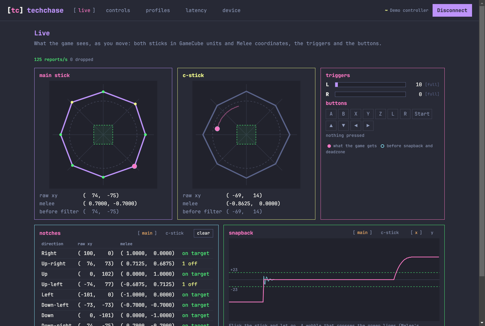

# [tc] techchase

![[tc] techchase: tournament firmware for the GC Ultimate](assets/logo.png)

The all-in-one controller utility for PhobGCC and the GC Ultimate: calibrate them and cut their
input lag in one place, so aftermarket controllers get the same lag reduction and are ready for
tournaments. Today it's tournament firmware and a setup app for the Hand Held Legend GC Ultimate;
Phob support is next.

> **Work in progress.** The firmware runs on a GC Ultimate R4K and passes its tests on hardware.
> Phob support, the Switch 2 timing and the Rust desktop app are next (see Roadmap). Not affiliated
> with Hand Held Legend or PhobGCC.



## What it does

- **Late-latch.** The controller learns when the PC or console reads it, then reads its buttons
  and sticks just before that moment, not up to a whole poll early. Measured on the controller:
  SInput 934 → 358 µs average input age, Slippi at 1 kHz 1036 → 388 µs (worst case 3021 → 422 µs).
- **Faster button scan.** Each row of the button matrix settles in 4 µs, not 15.
- **Quick Remap on the controller.** Hold Power + Start, press a button, then press the button whose
  job it should do. Saved at once, used in every mode, no computer needed.
- **Live view.** Your controller as the game sees it, like GTS's controller test but with no
  Dolphin: both sticks with raw and Melee coordinates, triggers, buttons, a notch check that
  measures all eight directions, and a snapback oscilloscope with Melee's deadzone marked.
- **Remapping.** A picture of your controller: click a button, pick its job, labeled with Smash
  actions (Attack, Special, Jump, Grab, Shield) or GameCube names. Named profiles, a live latency
  view with a one-click A/B test, USB mode switching and settings backup.
- **Same settings as HHL's.** No settings layout changed, so HHL's web app still does calibration,
  RGB and snapback, and going back to official firmware keeps your setup.

## Install

The firmware:

1. Unplug the controller. Hold **ZL + Start** and plug it in: a drive appears.
2. Drag `gcu_r4k.uf2` onto it. The controller restarts on its own. Until releases are set up, build
   the file yourself (see Develop).

To go back, do the same with the official `gcu_r4k.uf2` from HHL's web app. Your settings stay.

The app needs Python 3 and Chrome or Edge:

```sh
python tools/app/serve.py          # opens the app; Connect, then pick the controller
python tools/app/serve.py --demo   # no controller needed
```

## Controls

Quick Remap, on the controller:

| Input | What it does |
|---|---|
| Hold Power + Start, 1.5 s | Start Quick Remap: the LED pulses purple and the game sees the controller at rest |
| Press a button, then another | The first button now does the second one's job (two ticks, green flash) |
| Hold Start, 3 s | Reset every button (orange flash) |
| Tap Power | Finish (or leave it alone for 20 s) |
| Hold ZL + Start while plugging in | Firmware update drive |

In the app, picking a button's own job puts it back to default. To swap two buttons, change both.

## How it's built

C on the Pico SDK for the firmware, like the HOJA firmware it's built on. The RP2040's speed isn't
what makes the delay: when the input is read is, and that's scheduling. The app is plain HTML, CSS
and JavaScript over WebUSB, with no build step. The tools are Python.

| Path | What it is |
|---|---|
| `firmware/patches/` | The changes to HHL's `hoja-device-fw` and `HOJA-LIB-RP2040`, one patch each |
| `firmware/UPSTREAM` | The upstream commits the patches apply to |
| `firmware/*.sh` | Clone and patch upstream, or export the patches from a working checkout |
| `tools/app/` | The app: `index.html`, `app.js`, `gcu-protocol.js` (the USB protocol), `style.css` |
| `tools/app/live.js` | The live view: sticks, triggers, buttons, notch check, oscilloscope |
| `tools/app/melee.js` | GameCube and Melee stick math, checked against GTS readings |
| `tools/gcu.py` | Command line: info, stats, A/B test, map, remap, reset, mode, backup |
| `tools/slippi_poll_ab.py` | Polls like Slippi Dolphin at 1 kHz and A/B tests the late-latch |
| `tests/sim_latch.c` | Runs the real late-latch code on a PC against simulated polls |
| `tests/app/` | Protocol test on a real controller, Melee math test, and a UI test in headless Chrome |
| `assets/` | The README banner (`render.mjs`) and screenshot |
| `PLAN.md` | The plan, phase by phase, with the measurements |

## Develop

```sh
firmware/apply-patches.sh                          # clones HHL's firmware into upstream/ and patches it
cmake -S upstream/hoja-device-fw/rp2040 -B build -G Ninja -DCMAKE_BUILD_TYPE=Release \
  -DPICO_SDK_PATH=<pico-sdk 2.2.0> -DHOJA_ONLY_PROJECTS=gcu_1 -DHOJA_PUBLISH_DIR="$PWD/out"
ninja -C build -j 8 gcu_1                          # writes out/gcu_r4k/gcu_r4k.uf2
firmware/export-patches.sh                         # after changing upstream/, refresh the patches

gcc -O2 -Wall -Wextra -DPICO_RP2040 -Itests/stubs \
  -Iupstream/hoja-device-fw/library/HOJA-LIB-RP2040/include \
  tests/sim_latch.c upstream/hoja-device-fw/library/HOJA-LIB-RP2040/src/utilities/latch.c -o sim_latch
./sim_latch                                        # late-latch simulation

python tools/app/serve.py --no-browser --port 8474 &
node tests/app/ui_smoke.mjs                        # UI test, headless Chrome
node tests/app/melee_test.mjs                      # Melee coordinates against GTS readings
cd tests/app && npm install && node protocol_test.mjs   # needs the controller; restores your layout
node tests/app/live_check.mjs                      # live report from the controller, 2 s

python -m venv .venv && .venv/bin/pip install -r tools/requirements.txt
```

The Pico SDK and Arm toolchain come with the Raspberry Pi Pico extension for VS Code. Code rules are
in `CONTRIBUTING.md`: no panics outside tests, no unchecked casts, every lint exception explained.

## Roadmap

Done:

- [x] **Late-latch** over USB, measured on hardware in SInput and Slippi modes.
- [x] **Quick Remap** on the controller, and one remap for every mode.
- [x] **The app**: live view, controls, profiles, latency and device screens, in Dracula.
- [x] **Command-line tools** and a Slippi-style A/B poller.

Next:

- [ ] **Switch 2**: session stats saved on the controller, then late-latch for its 4 ms and 8/8/9 ms
  report cadences.
- [ ] **PC**: OpenSmash's adapter reader and Slippi Dolphin at a true 1 kHz.
- [ ] **Phob parity**: measure against a PhobGCC end to end, stick filter delay, notch calibration.
- [ ] **Phob support**: read a PhobGCC through a GameCube adapter into the live view, guided
  calibration without the config ROM in Dolphin, then its input lag.
- [ ] **Rust**: one core for the protocol and Melee math, a Tauri desktop app, a WebAssembly build
  for phones, with CI, lints and releases.
- [ ] **Guided calibration** for the GC Ultimate inside the live view.
- [ ] **LED colors** for the GC Ultimate, with presets and a low-key venue setting.
- [ ] **Bluetooth**, then a tournament lock and venue guide.

## Credits

Built on [HOJA](https://github.com/HandHeldLegend/hoja-device-fw) by Hand Held Legend, with the
[Pico SDK](https://github.com/raspberrypi/pico-sdk) and [TinyUSB](https://github.com/hathach/tinyusb).
[JetBrains Mono](https://github.com/JetBrains/JetBrainsMono) (SIL OFL 1.1) and the
[Dracula](https://draculatheme.com) palette (MIT). Code rules from scadoshi's `scadoshi-rust`.

[CC BY-NC-SA 3.0](LICENSE), the same as HOJA: share it and change it, credit the authors, keep it
non-commercial, and share changes under the same license.
