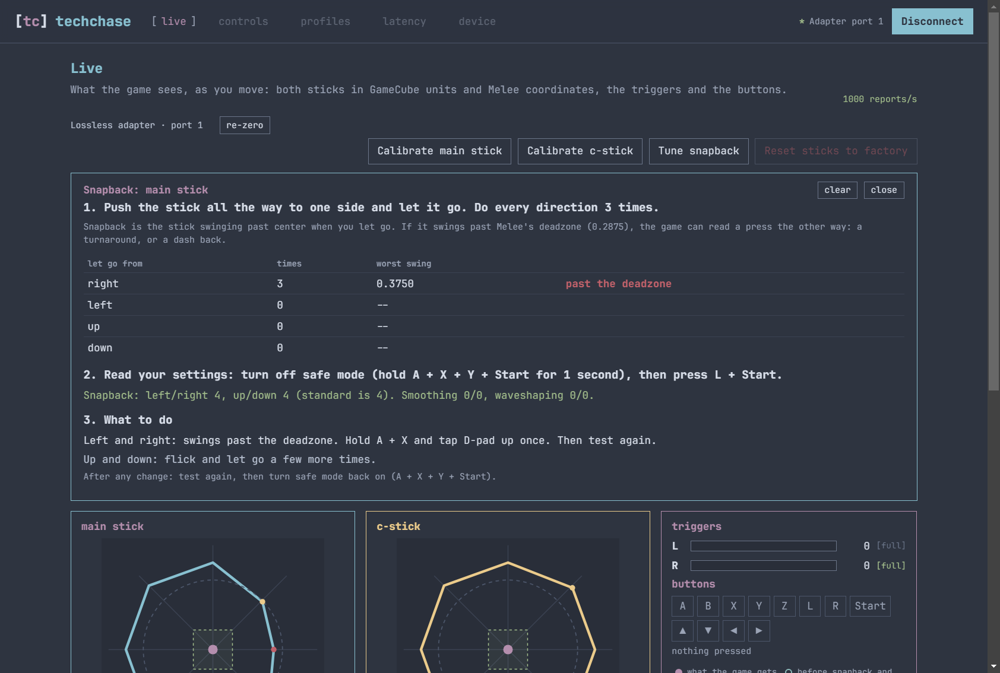

# [tc] techchase

![[tc] techchase](assets/logo.png)

Calibrate your PhobGCC without Dolphin or a config ROM. Plug the Phob into a GameCube adapter, open
the techchase desktop app, and it walks you through the Phob's own calibration one step at a time:
it shows the target the Phob is asking for, where your stick lands in Melee coordinates, and which
button to tap to fix a notch. Then it measures your snapback and tells you exactly which buttons
change it.

techchase is the all-in-one controller utility for PhobGCC and the GC Ultimate: one place to
calibrate them and cut their input lag, so aftermarket controllers are ready for tournaments. It
also has tournament firmware and a setup app for the Hand Held Legend GC Ultimate.

> **Work in progress.** The Phob guide is new: it's tested against the Phob's own source and a
> recorded run, and is being tried on real Phobs now. Not affiliated with Hand Held Legend or
> PhobGCC.


## Phob

Everything here reads the Phob through a GameCube adapter at 1000 reports a second, the way Dolphin
does. A Phob changes its settings with button combos, so the app watches what the Phob shows on its
sticks and tells you what to press next.

- **Guided calibration**, main stick and c-stick. One instruction at a time: turn off safe mode,
  start, measure each point, then fine-tune each notch. The app follows along on its own and joins
  a calibration already under way.
- **Notch fine-tuning in Melee coordinates.** Each notch shows where it lands (0.7000, 0.7000 is a
  perfect diagonal) and says "Tap X" or "Tap Y" until it's on target.
- **Snapback tuner.** Flick the stick and let go: the app measures how far it swings past center in
  each direction and marks any swing past Melee's deadzone (0.2875). It reads your settings back
  (L + Start) and says which combo to press, then measures again.
- **Live view and notch check.** Both sticks as the game reads them, raw and in Melee coordinates,
  with all eight notches measured.



## GC Ultimate

- **Late-latch.** The controller learns when the PC or console reads it, then reads its buttons
  and sticks just before that moment, not up to a whole poll early. Measured on the controller:
  SInput 934 → 358 µs average input age, Slippi at 1 kHz 1036 → 388 µs (worst case 3021 → 422 µs).
- **Faster button scan.** Each row of the button matrix settles in 4 µs, not 15.
- **Quick Remap on the controller.** Hold Power + Start, press a button, then press the button whose
  job it should do. Saved at once, used in every mode, no computer needed.
- **Live view.** Your controller as the game sees it, like GTS's controller test but with no
  Dolphin: both sticks with raw and Melee coordinates, triggers, buttons, a notch check that
  measures all eight directions, and a snapback oscilloscope with Melee's deadzone marked.
- **Stick calibration and snapback.** Guided notch calibration, a reset to factory, and the snapback
  tuner, which shows the swing before and after the filter and sets the filter (Auto, low-pass,
  off) in one click.
- **Remapping.** A picture of your controller: click a button, pick its job, labeled with Smash
  actions (Attack, Special, Jump, Grab, Shield) or GameCube names. Named profiles, a live latency
  view with a one-click A/B test, USB mode switching and settings backup.
- **Dolphin check.** Shows how each Dolphin port reads the controller. For Melee, Slippi mode with
  the port on "GameCube Adapter for Wii U" means Dolphin does no mapping, so remaps reach the game
  as set. A Standard Controller port with the wrong button numbers can be fixed in one click (the
  old settings are backed up first).
- **Same settings as HHL's.** No settings layout changed, so HHL's web app still works, and going
  back to official firmware keeps your setup.


## Install

The desktop app (Windows) runs the Phob tools and everything for the GC Ultimate. Until releases
are set up, build it with Rust:

```sh
cd rust
cargo build --release -p techchase-app   # writes rust/target/release/techchase.exe
```

The adapter needs the same driver setup Dolphin uses (for Nintendo's adapter, WinUSB through
Zadig). Close Dolphin while techchase has the adapter open.

The GC Ultimate firmware:

1. Unplug the controller. Hold **ZL + Start** and plug it in: a drive appears.
2. Drag `gcu_r4k.uf2` onto it. The controller restarts on its own. Until releases are set up, build
   the file yourself (see Develop).

To go back, do the same with the official `gcu_r4k.uf2` from HHL's web app. Your settings stay.

The GC Ultimate also works from a browser, with Python 3 and Chrome or Edge:

```sh
python tools/app/serve.py          # opens the app; Connect, then pick the controller
python tools/app/serve.py --demo   # no controller needed
```

## GC Ultimate controls

Quick Remap, on the controller:

| Input | What it does |
|---|---|
| Hold Power + Start, 1.5 s | Start Quick Remap: the LED pulses purple and the game sees the controller at rest |
| Press a button, then another | The first button now does the second one's job (two ticks, green flash) |
| Hold Start, 3 s | Reset every button (orange flash) |
| Tap Power | Finish (or leave it alone for 20 s) |
| Hold ZL + Start while plugging in | Firmware update drive |

In the app, picking a button's own job puts it back to default. To swap two buttons, change both.

## How it's built

C on the Pico SDK for the firmware, like the HOJA firmware it's built on. The RP2040's speed isn't
what makes the delay: when the input is read is, and that's scheduling. The app is plain HTML, CSS
and JavaScript with no build step; the desktop app wraps it in Tauri and adds the GameCube adapter
from Rust. The tools are Python.

| Path | What it is |
|---|---|
| `firmware/patches/` | The changes to HHL's `hoja-device-fw` and `HOJA-LIB-RP2040`, one patch each |
| `firmware/UPSTREAM` | The upstream commits the patches apply to |
| `firmware/*.sh` | Clone and patch upstream, or export the patches from a working checkout |
| `tools/app/` | The app: `index.html`, `app.js`, `gcu-protocol.js` (the USB protocol), `style.css` |
| `tools/app/live.js` | The live view: sticks, triggers, buttons, notch check, oscilloscope |
| `tools/app/calibration.js`, `calib-ui.js` | Guided stick calibration: the analog settings layout, notch capture, and the wizard |
| `tools/app/melee.js` | GameCube and Melee stick math, checked against GTS readings |
| `tools/app/adapter-source.js` | GameCube adapter reports into the live view, with Dolphin's origin |
| `tools/app/phob-track.js`, `phob-calib.js` | The Phob guide: follows the Phob's calibration from what it shows, and says what to do next |
| `tools/app/snapback.js`, `snapback-ui.js` | The snapback tuner: swing measurement, advice for each controller, and the Phob's settings display |
| `tools/gcu.py` | Command line: info, stats, A/B test, map, remap, reset, mode, backup |
| `tools/dolphin_setup.py` | The Dolphin check, for the app and on its own: which port reads the controller, and fixing a mapping |
| `tools/button_check.py` | Press each button: what Windows receives, and what a Dolphin profile reads it as |
| `tools/slippi_poll_ab.py` | Polls like Slippi Dolphin at 1 kHz and A/B tests the late-latch |
| `rust/techchase-core` | The protocol, live reports, Melee math, stick calibration, layouts and profiles, in Rust with no USB |
| `rust/techchase-usb` | The USB side: the GC Ultimate's config interface, GameCube adapters with RAW_IO, and hot-plug |
| `rust/techchase-app` | The desktop app (Tauri): the app above plus the GameCube adapter, streamed at 1 kHz |
| `rust/techchase-cli` | `tc`: reads a GameCube adapter (a Phob on a Lossless) at 1 kHz, the GC Ultimate's info, stats, map, live stream and protocol check, and watches devices come and go |
| `tests/sim_latch.c` | Runs the real late-latch code on a PC against simulated polls, including slow reports that must not leave it stuck off |
| `tests/slippi_dolphin_poll.py` | Polls Slippi mode exactly as Slippi Dolphin does, and fails on anything Dolphin would see as a drop |
| `tests/dolphin_setup_test.py` | The Dolphin check and fix, on a throwaway copy of Dolphin's settings |
| `tests/app/` | Protocol test on a real controller, Melee math, Phob guide and snapback tests, and UI tests in headless Chrome |
| `assets/` | The README banner (`render.mjs`) and screenshots |
| `PLAN.md` | The plan, phase by phase, with the measurements |

## Develop

```sh
firmware/apply-patches.sh                          # clones HHL's firmware into upstream/ and patches it
cmake -S upstream/hoja-device-fw/rp2040 -B build -G Ninja -DCMAKE_BUILD_TYPE=Release \
  -DPICO_SDK_PATH=<pico-sdk 2.2.0> -DHOJA_ONLY_PROJECTS=gcu_1 -DHOJA_PUBLISH_DIR="$PWD/out"
ninja -C build -j 8 gcu_1                          # writes out/gcu_r4k/gcu_r4k.uf2
firmware/export-patches.sh                         # after changing upstream/, refresh the patches

gcc -O2 -Wall -Wextra -DPICO_RP2040 -Itests/stubs \
  -Iupstream/hoja-device-fw/library/HOJA-LIB-RP2040/include \
  tests/sim_latch.c upstream/hoja-device-fw/library/HOJA-LIB-RP2040/src/utilities/latch.c -o sim_latch
./sim_latch                                        # late-latch simulation

node tests/app/ui_smoke.mjs                        # UI test, headless Chrome (starts its own server)
python tests/dolphin_setup_test.py                 # Dolphin check and fix, on a throwaway copy
node tests/app/calibration_test.mjs                # stick calibration math and settings layout
node tests/app/melee_test.mjs                      # Melee coordinates against GTS readings
node tests/app/transport_test.mjs                  # settings blocks read whole when packets arrive in bursts
node tests/app/phob_track_test.mjs                 # following a Phob's calibration from what it shows
node tests/app/phob_ui_test.mjs                    # the Phob guide and snapback tuner in the desktop app, with a fake adapter
node tests/app/snapback_test.mjs                   # snapback swings, advice, and reading the Phob's settings display
cd tests/app && npm install && node protocol_test.mjs   # needs the controller; restores your layout
node tests/app/live_check.mjs                      # live report from the controller, 2 s
.venv/bin/python tests/slippi_dolphin_poll.py      # controller in Slippi mode, Dolphin closed

python -m venv .venv && .venv/bin/pip install -r tools/requirements.txt

cd rust
cargo test                                         # the core: Melee math, calibration, protocol, profiles
cargo clippy --workspace --all-targets -- -D warnings
cargo +nightly fmt                                 # rustfmt.toml uses nightly options
cargo run --release --bin tc -- adapter           # a Phob on a Lossless adapter, port 1; Dolphin closed
cargo run --release --bin tc -- check             # GC Ultimate protocol check; restores your layout
cargo run --release --bin tc -- watch             # lists controllers and adapters as they're plugged in and out
```

The Pico SDK and Arm toolchain come with the Raspberry Pi Pico extension for VS Code. Code rules are
in `CONTRIBUTING.md`: no panics outside tests, no unchecked casts, every lint exception explained.

## Roadmap

Done:

- [x] **Late-latch** over USB, measured on hardware in SInput and Slippi modes.
- [x] **Quick Remap** on the controller, and one remap for every mode.
- [x] **The app**: live view, controls, profiles, latency and device screens, in Nord.
- [x] **Command-line tools** and a Slippi-style A/B poller.
- [x] **Desktop app** (Rust and Tauri) that reads a GameCube adapter at 1 kHz.
- [x] **Phob calibration guide** and **snapback tuner**, for Phobs on any GameCube adapter.
- [x] **Guided calibration and snapback** for the GC Ultimate inside the live view.

Next:

- [ ] **Switch 2**: session stats saved on the controller, then late-latch for its 4 ms and 8/8/9 ms
  report cadences.
- [ ] **PC**: OpenSmash's adapter reader and Slippi Dolphin at a true 1 kHz.
- [ ] **Phob parity**: measure against a PhobGCC end to end, stick filter delay, notch calibration.
- [ ] **Phob, next**: waveshaping, smoothing and trigger settings decoded the same way, a check of
  the result against GTS, then the Phob's input lag.
- [ ] **Rust**: a WebAssembly build for phones, with CI and releases.
- [ ] **LED colors** for the GC Ultimate, with presets and a low-key venue setting.
- [ ] **Bluetooth**, then a tournament lock and venue guide.

## Credits

Built on [HOJA](https://github.com/HandHeldLegend/hoja-device-fw) by Hand Held Legend, with the
[Pico SDK](https://github.com/raspberrypi/pico-sdk) and [TinyUSB](https://github.com/hathach/tinyusb).
[JetBrains Mono](https://github.com/JetBrains/JetBrainsMono) (SIL OFL 1.1) and the
[Nord](https://www.nordtheme.com) palette (MIT), as Ghostty ships it. Code rules from scadoshi's `scadoshi-rust`.

[CC BY-NC-SA 3.0](LICENSE), the same as HOJA: share it and change it, credit the authors, keep it
non-commercial, and share changes under the same license.
