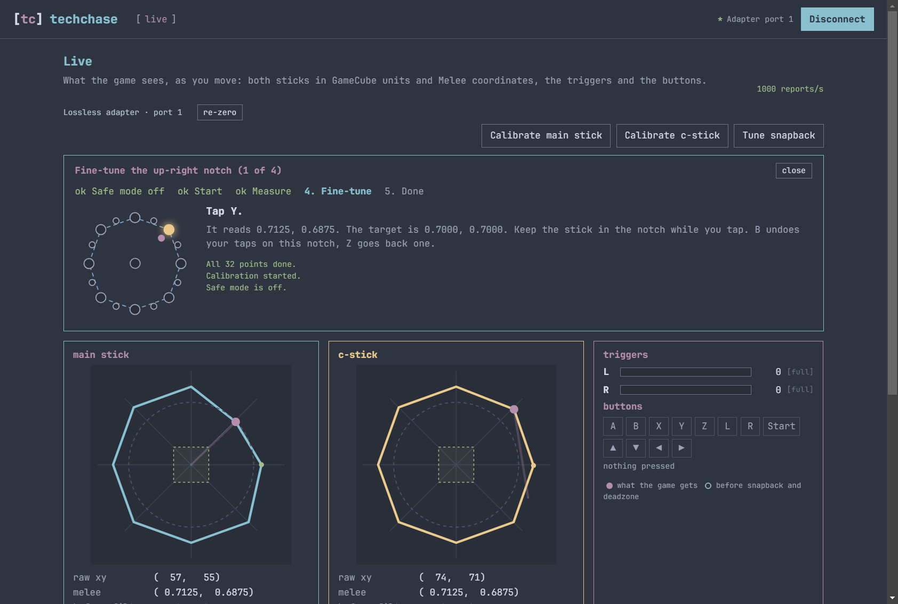

# [tc] techchase

![[tc] techchase: PhobGCC calibration, no Dolphin needed](assets/logo.png)

Calibrate your PhobGCC without Dolphin or a config ROM. Plug the Phob into a GameCube adapter, open
techchase, and it walks you through the Phob's own calibration one step at a time: the target the
Phob is asking for, where your stick lands in Melee coordinates, and which button to tap to fix a
notch. Then it measures your snapback and tells you exactly which buttons change it.

**[Download techchase.exe](https://github.com/moontourist/techchase/releases/latest)** for Windows
10 or 11. Nothing to install: download it and run it.

> **Work in progress.** The Phob guide is new: it's tested against the Phob's own source and a
> recorded run, and is being tried on real Phobs now. Not affiliated with PhobGCC or Hand Held
> Legend.



## What it does

techchase reads the Phob through a GameCube adapter at 1000 reports a second, the way Dolphin does.
A Phob changes its settings with button combos, so techchase watches what the Phob shows on its
sticks and tells you what to press next.

- **Guided calibration**, main stick and c-stick. One instruction at a time: turn off safe mode,
  start, measure each point, then fine-tune each notch. techchase follows along on its own, and
  can join a calibration you already started.
- **Notch fine-tuning in Melee coordinates.** Each notch shows where it lands (0.7000, 0.7000 is a
  perfect diagonal) and says "Tap X" or "Tap Y" until it's on target.
- **Snapback tuner.** Flick the stick and let go: techchase measures how far it swings past center
  in each direction and marks any swing past Melee's deadzone (0.2875), where the game can read a
  press the other way. It reads your settings back (L + Start), says which combo to press, then
  measures again.
- **Live view and notch check.** Both sticks as the game reads them, raw and in Melee coordinates,
  with all eight notches measured, like GTS's controller test without Dolphin.


## Quick start

You need a Phob (PhobGCC firmware with the standard calibration combos; built against 0.29), a
GameCube adapter (Lossless or Nintendo's), and a Windows PC.

1. Download `techchase.exe` and run it. The exe isn't code-signed, so the first time Windows may
   say "Windows protected your PC": press **More info**, then **Run anyway**.
2. Close Dolphin: only one program can read the adapter at a time.
3. Plug the Phob into the adapter and press **Use adapter**.
4. Press **Calibrate main stick** and do what it says. Then **Calibrate c-stick**, and **Tune
   snapback**.

The adapter needs the same driver setup Dolphin uses (for Nintendo's adapter, WinUSB through
Zadig). If Dolphin can read your adapter, so can techchase.

## GC Ultimate

techchase started as tournament firmware for the Hand Held Legend GC Ultimate, and the same app
sets it up. The firmware:

- **Late-latch.** The controller learns when the PC or console reads it, then reads its buttons
  and sticks just before that moment, not up to a whole poll early. Measured on the controller:
  SInput 934 → 358 µs average input age, Slippi at 1 kHz 1036 → 388 µs (worst case 3021 → 422 µs).
- **Faster button scan.** Each row of the button matrix settles in 4 µs, not 15.
- **Quick Remap on the controller.** Hold Power + Start, press a button, then press the button whose
  job it should do. Saved at once, used in every mode, no computer needed.
- **Same settings as HHL's.** No settings layout changed, so HHL's web app still works, and going
  back to official firmware keeps your setup.

And in the app, with the GC Ultimate on USB:

- **Live view** with both sticks before and after the filter, and a snapback oscilloscope.
- **Stick calibration and snapback.** Guided notch calibration, a reset to factory, and the snapback
  tuner, which sets the filter (Auto, low-pass, off) in one click.
- **Remapping.** A picture of your controller: click a button, pick its job, labeled with Smash
  actions (Attack, Special, Jump, Grab, Shield) or GameCube names. Named profiles, a live latency
  view with a one-click A/B test, USB mode switching and settings backup.
- **Dolphin check.** Shows how each Dolphin port reads the controller. For Melee, Slippi mode with
  the port on "GameCube Adapter for Wii U" means Dolphin does no mapping, so remaps reach the game
  as set. A Standard Controller port with the wrong button numbers can be fixed in one click (the
  old settings are backed up first).


### Install the firmware

1. Unplug the controller. Hold **ZL + Start** and plug it in: a drive appears.
2. Drag `gcu_r4k.uf2` onto it. The controller restarts on its own. Until the firmware is in the
   releases, build the file yourself (see Develop).

To go back, do the same with the official `gcu_r4k.uf2` from HHL's web app. Your settings stay.

The GC Ultimate also works from a browser, with Python 3 and Chrome or Edge:

```sh
python tools/app/serve.py          # opens the app; Connect, then pick the controller
python tools/app/serve.py --demo   # no controller needed
```

### Controls

Quick Remap, on the controller:

| Input | What it does |
|---|---|
| Hold Power + Start, 1.5 s | Start Quick Remap: the LED pulses purple and the game sees the controller at rest |
| Press a button, then another | The first button now does the second one's job (two ticks, green flash) |
| Hold Start, 3 s | Reset every button (orange flash) |
| Tap Power | Finish (or leave it alone for 20 s) |
| Hold ZL + Start while plugging in | Firmware update drive |

In the app, picking a button's own job puts it back to default. To swap two buttons, change both.

## How it's built

The app is plain HTML, CSS and JavaScript with no build step. The desktop app wraps it in Tauri and
reads the GameCube adapter from Rust. The GC Ultimate firmware is C on the Pico SDK, like the HOJA
firmware it's built on: the RP2040's speed isn't what makes the delay, when the input is read is,
and that's scheduling. The tools are Python.

| Path | What it is |
|---|---|
| `tools/app/` | The app: `index.html`, `app.js`, `style.css` |
| `tools/app/phob-track.js`, `phob-calib.js` | The Phob guide: follows the Phob's calibration from what it shows, and says what to do next |
| `tools/app/snapback.js`, `snapback-ui.js` | The snapback tuner: swing measurement, advice for each controller, and the Phob's settings display |
| `tools/app/adapter-source.js` | GameCube adapter reports into the live view, with Dolphin's origin |
| `tools/app/live.js` | The live view: sticks, triggers, buttons, notch check, oscilloscope |
| `tools/app/melee.js` | GameCube and Melee stick math, checked against GTS readings |
| `tools/app/gcu-protocol.js`, `calibration.js`, `calib-ui.js` | The GC Ultimate: its USB protocol, analog settings layout and calibration wizard |
| `rust/techchase-app` | The desktop app (Tauri): the app above plus the GameCube adapter, streamed at 1 kHz |
| `rust/techchase-usb` | The USB side: GameCube adapters with RAW_IO, the GC Ultimate's config interface, and hot-plug |
| `rust/techchase-core` | The protocol, live reports, Melee math, stick calibration, layouts and profiles, in Rust with no USB |
| `rust/techchase-cli` | `tc`: reads a GameCube adapter (a Phob on a Lossless) at 1 kHz, the GC Ultimate's info, stats, map, live stream and protocol check, and watches devices come and go |
| `firmware/patches/` | The GC Ultimate firmware: changes to HHL's `hoja-device-fw` and `HOJA-LIB-RP2040`, one patch each |
| `firmware/UPSTREAM` | The upstream commits the patches apply to |
| `firmware/*.sh` | Clone and patch upstream, or export the patches from a working checkout |
| `tools/gcu.py` | GC Ultimate command line: info, stats, A/B test, map, remap, reset, mode, backup |
| `tools/dolphin_setup.py` | The Dolphin check, for the app and on its own: which port reads the controller, and fixing a mapping |
| `tools/button_check.py` | Press each button: what Windows receives, and what a Dolphin profile reads it as |
| `tools/slippi_poll_ab.py` | Polls like Slippi Dolphin at 1 kHz and A/B tests the late-latch |
| `tests/app/` | Phob guide and snapback tests, Melee math, a protocol test on a real controller, and UI tests in headless Chrome |
| `tests/sim_latch.c` | Runs the real late-latch code on a PC against simulated polls, including slow reports that must not leave it stuck off |
| `tests/slippi_dolphin_poll.py` | Polls Slippi mode exactly as Slippi Dolphin does, and fails on anything Dolphin would see as a drop |
| `tests/dolphin_setup_test.py` | The Dolphin check and fix, on a throwaway copy of Dolphin's settings |
| `.github/workflows/release.yml` | Builds the standalone `techchase.exe` and drafts a release for each version tag |
| `assets/` | The README banner (`render.mjs`) and screenshots |
| `PLAN.md` | The plan, phase by phase, with the measurements |

## Develop

The desktop app, with Rust and Visual Studio's C++ tools:

```sh
cd rust
cargo build --release -p techchase-app             # writes rust/target/release/techchase.exe
cargo test                                         # the core: Melee math, calibration, protocol, profiles
cargo clippy --workspace --all-targets -- -D warnings
cargo +nightly fmt                                 # rustfmt.toml uses nightly options
cargo run --release --bin tc -- adapter           # a Phob on a Lossless adapter, port 1; Dolphin closed
cargo run --release --bin tc -- watch             # lists controllers and adapters as they're plugged in and out
```

The app's tests:

```sh
node tests/app/phob_track_test.mjs                 # following a Phob's calibration from what it shows
node tests/app/phob_ui_test.mjs                    # the Phob guide and snapback tuner in the desktop app, with a fake adapter
node tests/app/snapback_test.mjs                   # snapback swings, advice, and reading the Phob's settings display
node tests/app/melee_test.mjs                      # Melee coordinates against GTS readings
node tests/app/ui_smoke.mjs                        # the app with a demo GC Ultimate, headless Chrome
node tests/app/calibration_test.mjs                # GC Ultimate stick calibration math and settings layout
node tests/app/transport_test.mjs                  # settings blocks read whole when packets arrive in bursts
python tests/dolphin_setup_test.py                 # Dolphin check and fix, on a throwaway copy
```

The GC Ultimate firmware and its hardware tests:

```sh
firmware/apply-patches.sh                          # clones HHL's firmware into upstream/ and patches it
cmake -S upstream/hoja-device-fw/rp2040 -B build -G Ninja -DCMAKE_BUILD_TYPE=Release \
  -DPICO_SDK_PATH=<pico-sdk 2.2.0> -DHOJA_ONLY_PROJECTS=gcu_1 -DHOJA_PUBLISH_DIR="$PWD/out"
ninja -C build -j 8 gcu_1                          # writes out/gcu_r4k/gcu_r4k.uf2
firmware/export-patches.sh                         # after changing upstream/, refresh the patches

gcc -O2 -Wall -Wextra -DPICO_RP2040 -Itests/stubs \
  -Iupstream/hoja-device-fw/library/HOJA-LIB-RP2040/include \
  tests/sim_latch.c upstream/hoja-device-fw/library/HOJA-LIB-RP2040/src/utilities/latch.c -o sim_latch
./sim_latch                                        # late-latch simulation

python -m venv .venv && .venv/bin/pip install -r tools/requirements.txt
cd tests/app && npm install && node protocol_test.mjs   # needs the controller; restores your layout
node tests/app/live_check.mjs                      # live report from the controller, 2 s
.venv/bin/python tests/slippi_dolphin_poll.py      # controller in Slippi mode, Dolphin closed
cd rust && cargo run --release --bin tc -- check   # GC Ultimate protocol check; restores your layout
```

The Pico SDK and Arm toolchain come with the Raspberry Pi Pico extension for VS Code. Code rules are
in `CONTRIBUTING.md`: no panics outside tests, no unchecked casts, every lint exception explained.

## Roadmap

Done:

- [x] **Phob calibration guide** and **snapback tuner**, for Phobs on any GameCube adapter.
- [x] **Desktop app** (Rust and Tauri) that reads a GameCube adapter at 1 kHz, as a standalone exe.
- [x] **GC Ultimate firmware**: late-latch over USB, measured in SInput and Slippi modes, and
  Quick Remap on the controller.
- [x] **GC Ultimate setup**: live view, guided calibration and snapback, controls, profiles,
  latency and device screens.

Next:

- [ ] **Phob**: smoothing, waveshaping and trigger settings guided the same way, a check of the
  result against GTS, then the Phob's input lag.
- [ ] **Phob parity**: measure a Phob and a GC Ultimate end to end, including stick filter delay.
- [ ] **A phone version** (WebAssembly) for setting up at a venue.
- [ ] **GC Ultimate**: Switch 2 timing, OpenSmash and Slippi Dolphin at a true 1 kHz, LED colors,
  Bluetooth, and a tournament lock.

## Credits

Built on [HOJA](https://github.com/HandHeldLegend/hoja-device-fw) by Hand Held Legend, with the
[Pico SDK](https://github.com/raspberrypi/pico-sdk) and [TinyUSB](https://github.com/hathach/tinyusb).
The Phob guide follows [PhobGCC](https://github.com/PhobGCC/PhobGCC-SW)'s calibration and settings combos; it uses none of its code.
[JetBrains Mono](https://github.com/JetBrains/JetBrainsMono) (SIL OFL 1.1) and the
[Nord](https://www.nordtheme.com) palette (MIT), as Ghostty ships it. Code rules from scadoshi's `scadoshi-rust`.

[CC BY-NC-SA 3.0](LICENSE), the same as HOJA: share it and change it, credit the authors, keep it
non-commercial, and share changes under the same license.
